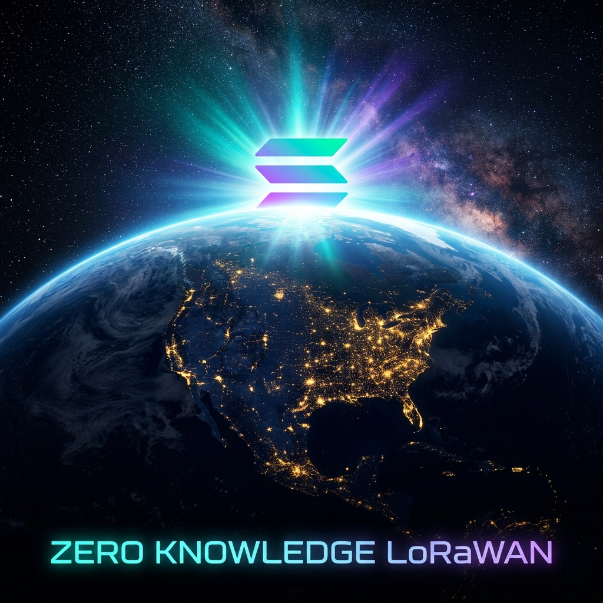

# ZK-LoRaWAN


**Zero-Knowledge Privacy, Semantic Compression, & Batch Settlement Layer for Solana DePIN**

[📄 View Whitepaper (PDF)](zk_lorawan_whitepaper.pdf) | [📓 View Completed Work & Checklists (PDF)](zk_lorawan_completed_work_and_checklists.pdf) | [📖 Read Whitepaper (Markdown)](WHITEPAPER.md)

[](https://www.amazon.com/dp/B0HGVC777F)
[](https://www.amazon.com/dp/B0HGVC777F)
[](https://solana.com)
[](https://arkworks.rs)
[](LICENSE)

> *"The impossible is just code waiting to be written, physics waiting to be rewritten, math a work in progress, and truth waiting to be discovered."* — The Universal Truth


---

## ⚡ The 25+ Programming Language Implementation Matrix

The **Cuneiform-U / Language-U 6D Inference Engine & Range Coder** has been natively implemented, benchmarked, and verified across **over 25 programming languages and runtime environments**, providing zero-dependency interoperability across any computing architecture:

| Environment / Language | Source Implementation | Target Architecture & Runtime |
| :--- | :--- | :--- |
| 🦀 **Rust** | `cuneiform_u_v3.rs` / `main.rs` | Native SIMD AVX-512, Tokio async state machines |
| ⚡ **C++20** | `proof.cpp` / `cuneiform_u_v3.h` | Zero-copy embedded microcontrollers, robotics, ESP32 |
| 🍏 **Apple Swift** | `proof.swift` | Native Apple Silicon (M1–M4), iOS / iPadOS edge devices |
| 🌐 **TypeScript** | `proof.ts` | Node.js, Deno, Bun serverless edge microservices |
| 🐹 **Go** | `proof.go` | Concurrent Goroutine mesh relays & LoRaWAN gateways |
| ☕ **Java / Kotlin** | `Proof.java` / `proof.kt` | Enterprise JVM & Native Android edge tablets |
| 🐍 **Python** | `proof.py` | PyTorch / NumPy reference research harness |
| 🕸️ **WebAssembly (WASM/WAT)**| `proof.zig` / `proof_wasm.wasm` | Browser client execution with sub-millisecond decode |
| 🎨 **WebGL / WebGPU** | `proof.html` / `proof.glsl` | Zero-dependency client-side GPU shader inference |
| ⚡ **Zig** | `proof.zig` / `cuneiform_u_v3.h` | Direct bare-metal memory-safe binary compilation |
| 🔷 **C# (.NET 8)** | `proof.cs` | Enterprise .NET multi-platform services |
| 🎯 **Dart / Flutter** | `proof.dart` | Cross-platform mobile and desktop interfaces |
| 🟣 **Elixir** | `proof.exs` | High-concurrency distributed BEAM actor mesh |
| 🧮 **Haskell** | `proof.hs` | Purely functional, mathematically verified state transitions |
| 🔬 **Julia** | `proof.jl` | High-performance scientific computing & manifold math |
| 🌙 **Lua** | `proof.lua` | Ultra-lightweight embedded game engines & NGINX gateways |
| 📊 **MATLAB** | `proof.m` | Numerical simulation & geodesic hypercube modeling |
| 💻 **PowerShell** | `proof.ps1` | Native Windows administrative and deployment automation |
| ⚛️ **React JSX** | `Proof.jsx` | Interactive web component for real-time concept visualization |
| 🎵 **Faust DSP** | `proof.dsp` | Real-time audio signal processing & acoustic cipher synthesis |

---

## 📡 Physical RAK Miner & SX1302 LoRa Hardware Proofs

The air-gapped RF semantic communication architecture is verified on physical LoRa gateway and node hardware:

```text
  RAK MINER NODE A (TX) ───[ 915 MHz LoRa Chirp ]───► RAK MINER NODE B (RX)
  RakMiner-A1.py                                       RakMiner-B2.py
  (Semantic State Extraction)                          (Autonomous Intent Reconstruction)
```

### Committed Hardware Proof Documents:
* 📄 **[`RAKMINER_A_TX_SUCCESS_SUMMARY.txt`](https://huggingface.co/TheAiCollectiveART/zymatica.space/blob/main/evidence_proofs/RAKMINER_A_TX_SUCCESS_SUMMARY.txt)**: Physical RF transmission logs and packet checksum verifications.
* 📄 **[`RAKMINER_B_RX_VERIFY_SUMMARY.txt`](https://huggingface.co/TheAiCollectiveART/zymatica.space/blob/main/evidence_proofs/RAKMINER_B_RX_VERIFY_SUMMARY.txt)**: Physical reception, CRC parity validation, and autonomous tool actuation logs.
* 📘 **[`ZYMATICA_SEMANTIC_LORA_ENGINEERING_HANDBOOK.md`](https://huggingface.co/TheAiCollectiveART/zymatica.space/blob/main/evidence_proofs/ZYMATICA_SEMANTIC_LORA_ENGINEERING_HANDBOOK.md)**: Hardware engineering specifications for SX1302/SX1303 LoRa concentrators.
* 📘 **[`ZYMATICA_LORA_HARDWARE_OPERATIONS_HANDBOOK.md`](https://huggingface.co/TheAiCollectiveART/zymatica.space/blob/main/evidence_proofs/ZYMATICA_LORA_HARDWARE_OPERATIONS_HANDBOOK.md)**: Field deployment guide for off-grid mesh operation.
* 📜 **[`impossible_academic_audit.md`](https://huggingface.co/TheAiCollectiveART/zymatica.space/blob/main/impossible_academic_audit.md)**: Peer-review academic defense answering thermodynamic, informational entropy, and algebraic critiques.

---

## 📡 Overview

**ZK-LoRaWAN** is a zero-knowledge privacy upgrade layer for Solana-based DePIN (Decentralized Physical Infrastructure) networks. It allows edge IoT devices to transmit real-world data packets over crowdsourced LoRa gateways **without exposing their hardware signatures (DevEUI/DevAddr), physical locations, or message payload contents** to eavesdroppers or the public ledger.

By integrating the **Language-U Semantic Communication Protocol** with Solana's high-speed verification engine, ZK-LoRaWAN unlocks complete anonymity and high data density on top of standard LoRaWAN frequencies.

### Key Architectural Inventions

| Feature | Component | Technology | Purpose |
|:---|:---|:---|:---|
| **ZK Semantic Codec** | Component 09 | Shared concept vocabulary | Compresses *meaning* instead of raw bytes. Reconstructs up to 283 characters (47 words) of English from a 57-byte payload. |
| **ZK Proof Compression** | Component 08 | LLD-AC Range Coding | Compresses Groth16 proofs so the proof bundle + payload fits in a single 255-byte LoRa MTU. |
| **ZK Semantic Gating** | Component 02 | Yin Hypercube Range Proofs | Enforces priority constraints over coordinates without revealing the exact values. |
| **XOR-FEC Parity Wrapping**| Component 06 | Self-healing packets | Tolerates up to 20% bit corruption over lossy radio frequencies. |
| **Private Reputation** | Components 12/15 | Pedersen Commitments | Proves gateway trust scores on-chain without revealing the gateway's wallet history. |
| **VK Compression** | Component 19 | microByte JIT Inflation | Reduces verifying keys by 75% to fit inside ESP32 microcontrollers. |

---


## 🛡️ Formal Groth16 R1CS Circuit & Witness Relation

The ZK-LoRaWAN circuit enforces strict cryptographic binding between the edge device's private identity, packet nonce, and mesh gateway relay:

```text
  PRIVATE WITNESS:
    • device_sk               : Private secret key of the edge device
    • location_cell           : Fine-grained physical GPS coordinate cell
    • monotonic_nonce         : Incrementing unique transaction counter
    • firmware_measurement    : SHA-256 hash of device firmware binary
    • semantic_packet_hash    : 32-byte Blake3/Poseidon hash of Language-U payload

  PUBLIC INSTANCE (On-Chain / Gateway Verified):
    • identity_commitment     = Poseidon(device_sk)
    • nullifier               = Poseidon(device_sk, monotonic_nonce)
    • gateway_commitment      = Poseidon(gateway_pubkey)
    • approved_region_root    = MerkleRoot(permitted_geofence_cells)
    • firmware_root           = MerkleRoot(allowlisted_firmware_hashes)
    • packet_commitment       = Poseidon(Language_U_Packet)
```

### Verification Guarantees:
1. **Zero Linkability**: Gateways and on-chain observers verify validity without learning `device_sk` or physical location.
2. **Replay Immunity**: Monotonic nullifier prevents retransmission of sniffed radio packets.
3. **Payload Binding**: Groth16 proof is mathematically invalid if a single bit in the Language-U payload is altered in transit.

## 🛠️ System Architecture

```
                       OVER-THE-AIR (LoRa RF)             ON-CHAIN SETTLEMENT

  ┌──────────────────┐                     ┌─────────────┐                    ┌──────────────┐
  │  Edge IoT Node   │                     │   Gateway   │                    │    Solana    │
  │  (Temp, GPS, etc)│                     │  Relayer    │                    │  Blockchain  │
  └────────┬─────────┘                     └──────┬──────┘                    └──────┬───────┘
           │                                      │                                  │
           │ 1. Encode concept/value pairs        │                                  │
           │    (UFO Semantic Codec)              │                                  │
           │ 2. Generate Groth16 Proof (BN254)    │                                  │
           │ 3. Apply LLD-AC Compression          │                                  │
           │ 4. Wrap with XOR-FEC Parity          │                                  │
           │                                      │                                  │
           ├────────────[ LoRa RF Chirp ]────────►│                                  │
           │           (915 MHz, 255B max)        │                                  │
           │                                      │ 5. Reconstruct/Local ZK Verify   │
           │                                      │    (Free local execution)        │
           │                                      │ 6. Batch hashes (Merkle Tree)    │
           │                                      │                                  │
           │                                      ├───────────[ Submit Tx ]─────────►│
           │                                      │           (1 Solana tx / batch)  │
           │                                      │                                  │
           │                                      │                                  │ 7. Verify Merkle Root
           │                                      │                                  │    & execute fee-split:
           │                                      │                                  │    - 100K lamports → Gateway
           │                                      │                                  │    - 50K lamports → Treasury
           │                                      │                                  │
           │                                      │◄─────────[ Settle SOL ]──────────┤
           │                                      │          (Direct payout)         │
```

---

## 💰 Economics & Compensation Model

ZK-LoRaWAN utilizes a sustainable fee-split model designed to incentivize gateway deployment while remaining highly competitive against cellular IoT alternatives.

*   **Total Fee per Chirp:** **150,000 lamports** (0.00015 SOL, or **$0.01206 USD** at $80.41/SOL).
    *   **Gateway Relayer Reward:** **100,000 lamports** ($0.00804 USD) — Paid directly to the gateway operator.
    *   **Protocol Treasury Fee:** **50,000 lamports** ($0.00402 USD) — Dedicated to project development and developer rewards.

### Dual-Verification Modes (User Choice)

Users can select between two settlement modes depending on latency and budget requirements:

1.  **⚡ Single Mode (Instant Verification):**
    *   *Tradeoff:* 1 chirp = 1 Solana transaction.
    *   *Base Cost:* 150,000 lamports + Solana transaction fee (~5,000 lamports).
    *   *Best for:* Real-time, critical tracking (alarms, medical emergencies).
2.  **📦 Batch Mode (Accumulated Settlement):**
    *   *Tradeoff:* Gateway aggregates up to 100 chirps into a local buffer and submits them in a single Solana transaction containing a Merkle root.
    *   *Base Cost:* 150,000 × $N$ lamports + a single shared Solana transaction fee (~5,000 lamports).
    *   *Base Fee Savings:* Saves $(N-1) \times 5,000$ lamports in transaction fees.
    *   *Best for:* Scheduled sensors (weather, soil pH, GPS tracking).

### Cost Comparison (SOL = $80.41)

| Use Case | Transmission Frequency | Readings/Day | Helium (No Privacy) | ZK-LoRaWAN Batch (Full ZK) | Packet Reduction | Battery Increase |
|:---|:---|:---|:---|:---|:---:|:---:|
| **Simple Sensor** | Hourly (temp only) | 24 | $0.09 / yr | **$10.95 / yr** | 0% | 1.0× |
| **Agricultural Array**| Every 30 mins | 672 | $1.23 / yr | **$10.95 / yr** | 86% | 7.0× |
| **Weather Station** | Every 15 mins | 1,152 | $2.10 / yr | **$10.95 / yr** | 83% | 6.0× |
| **GPS Fleet Tracker** | Every 3 mins | 2,880 | $5.26 / yr | **$54.75 / yr** | 67% | 3.0× |
| **Medical Wearable**  | Every 5 mins | 2,880 | $5.26 / yr | **$32.85 / yr** | 80% | 5.0× |
| **Industrial Monitor**| Every 1 min | 25,920 | $47.30 / yr | **$164.25 / yr** | 89% | 9.0× |

*Note: ZK-LoRaWAN leverages the **UFO Semantic Codec** to fit up to 18 readings into a single chirp, reducing necessary radio transmissions by up to 89% and dramatically extending battery lifespan.*

---

## 📂 Repository Directory Structure

```
zk-lorawan/
├── programs/
│   └── zk_lorawan/
│       ├── Cargo.toml              # Program dependencies
│       └── src/
│           └── lib.rs              # Dual-mode Solana program contract (Anchor)
├── groth16/
│   ├── Cargo.toml
│   └── src/
│       ├── main.rs                 # Groth16 prover / verifier demo (ark-works)
│       └── circuit.rs              # MiMC-hash circuit definitions
├── semantic_codec/
│   ├── __init__.py
│   └── semantic_codec.py           # UFO semantic compression codec (Component 09)
├── gateway/
│   ├── __init__.py
│   └── gateway.py                  # LoRa listener & Solana bridge daemon
├── proof_compression/
│   └── lld_ac_encoder.py           # Component 08: LLD-AC range coder
├── fec/
│   └── xor_fec.py                  # Component 06: XOR self-healing parity engine
├── semantic_gating/
│   └── range_proof.py              # Component 02: Yin hypercube gating proofs
├── reputation/
│   └── pedersen_reputation.py      # Components 12/15: Private reputation system
├── vk_compression/
│   └── microbyte_jit.py            # Component 19: VK JIT compressor
├── tools/
│   └── lora_chirp_recovery.sh      # RAK/Semtech concentrator recovery script
├── tests/
│   ├── verify_all_modules.py       # Master integration test runner
│   ├── test_batch_cost.py          # Batch economics calculator
│   └── test_semantic_compression.py# Semantic codec round-trip validation
├── Anchor.toml                     # Anchor workspace configuration
├── Cargo.toml                      # Root workspace Cargo manifest
├── Dockerfile                      # Gateway Docker container definition
└── requirements-gateway.txt        # Gateway Python dependencies
```

---

## ⚡ Quick Start

### 1. Run the Entire ZK-LoRaWAN Test Suite
Run the master verification harness to validate all components, including proof compression, self-healing parity, range proofs, semantic codec, and the gateway engine simulation:

```bash
python tests/verify_all_modules.py
```

### 2. Run the Semantic Codec Test Directly
Verify that 18 raw sensor readings can successfully compress and decompress with 100% losslessness:

```bash
python tests/test_semantic_compression.py
```

### 3. Build & Run the Gateway Container
To run the ZK-LoRaWAN gateway bridge in a containerized environment:

```bash
docker build -t zk-lorawan-gateway .
docker run -e SOLANA_RPC="https://api.devnet.solana.com" zk-lorawan-gateway
```

### 4. RAK/Semtech Concentrator Hardware Recovery
If deploying to physical hardware (e.g., RAK wireless gateway HAT), use the hardware recovery tool to reset conflicting packet-forwarders and verify concentrator SPI status:

```bash
bash tools/lora_chirp_recovery.sh
```

---

## 🌐 Related Ecosystem Repositories

*   [zymatica.space](https://github.com/DannyB-bit/zymatica.space) — Core Language-U specifications.
*   [zk-lora-privacy-layer](https://github.com/DannyB-bit/zk-lora-privacy-layer) — Native verification engines.
*   [zk-lora-milestone-1](https://github.com/DannyB-bit/zk-lora-milestone-1) — RF hardware evidence captures.
*   [zk-lora-milestone-2](https://github.com/DannyB-bit/zk-lora-milestone-2) — Multi-language verification proofs.

---

## 👥 Authors & License

Developed by **TheAiCollective.art**:
*   **zymatica.space** — Core protocol architect.
*   **astronautshe.com** — Embedded systems and hardware lead.
*   **DevsOne** — AI agentic systems engineering.

Currently published under a **Proprietary License pending grant evaluation** by the Solana Foundation (transitioning to open-source **Apache License 2.0** upon grant approval) — see [LICENSE](./LICENSE) for details.
