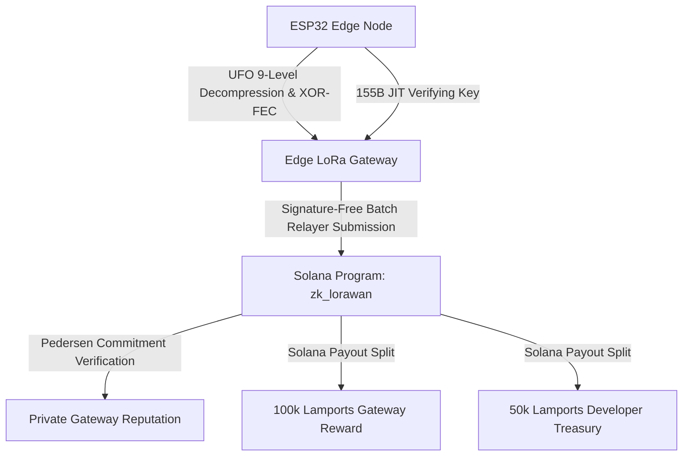

# Solana Foundation Grant Application — ZK-LoRaWAN Privacy Layer

## 🎯 Project Title
**ZK-LoRaWAN: Zero-Knowledge Privacy Layer for Solana DePIN Mesh Networks**

## 🏷️ One-Liner Description
An on-chain Groth16 zero-knowledge proof verification and private routing escrow program on Solana that anonymizes edge node identity and message metadata for physical mesh networks.

## 👥 Organization & Team
*   **Organization:** TheAiCollective.art / Zymatica
*   **Primary Contact:** Danny Bouldiez (`dannyb@zymatica.com`)
*   **GitHub Organization:** [DannyB-bit](https://github.com/DannyB-bit)
*   **Personal X Profile:** [@zymatica](https://x.com/zymatica)

## 🏦 Requested Funding (USDC / USDG)
**$12,000 total** (Phase 2 funding for advanced cryptographic verification and Mainnet-Beta rollout).

---

## 🚀 Executive Summary & Scope

ZK-LoRaWAN is a zero-knowledge privacy upgrade module designed specifically for Solana-based DePIN (Decentralized Physical Infrastructure) networks, such as the Zymatica Voice semantic mesh or Helium. Senders generate randomized Groth16 zero-knowledge proofs locally on low-power transmitter nodes (using curve BN254) to prove authorization to route packets through crowdsourced gateways without revealing their stable hardware UIDs, private keys, or location signatures to eavesdroppers. 

The payment, gateway routing verification, and protocol fee splits are fully managed on-chain via a custom Solana program built using the Anchor framework, programmatically collecting a protocol developer fee of exactly **50,000 lamports** and a gateway reward fee of **100,000 lamports** (totaling **150,000 lamports** per routing event) to fund long-term network maintenance and relayer incentives.

> [!IMPORTANT]
> **Devnet Status:** The core Anchor program has been successfully compiled and deployed on Solana Devnet.
> * **Program ID:** `4HRP2eV8qtYW54ozQmnGDjF7emwb8MvqFcF89UgSM6iC`
> * **Deployment Signature:** `57QqbvmR5TuqA9Ckzq1pCK1asedpKwRtrhb9fzoVdfrZYkUnVxu56nYfTLDZcGHPe4MwFM3W6KmHMYie4nQ47iv9`

---

## ⚠️ The Proposed Problem
1.  **DePIN Physical Location Tracking:** Public blockchain transactions require cryptographic signatures. If an edge LoRa node relays data and gets rewarded directly on-chain, an observer can correlate the physical radio transmission logs to the corresponding transaction signature on the public Solana ledger, enabling tracking of the node owner's location and identity.
2.  **Bandwidth and Latency Constraints:** Low-power radio links (like LoRaWAN) are highly constrained, typically limited to 255-byte frames. Transmitting heavy transaction signatures or public keys over the air is impossible.
3.  **Monetization of Open Networks:** Free and open routing meshes suffer from "tragedy of the commons" (nobody wants to pay for gateway power). Existing incentive solutions lack programmatic, secure fee splits for protocol developers to maintain software updates.

---

## 🛠️ The Proposed Solution: ZK-LoRaWAN
We solve this by decoupling packet identity from reward settlements using an on-chain zero-knowledge verification program:

1.  **On-Chain Private Escrows:** Senders initialize a dynamic `EscrowAccount` Program Derived Address (PDA) on Solana, locking up the gateway's reward of **100,000 lamports** plus a **50,000 lamports** developer fee.
2.  **Groth16 ZK-Proof Verification:** Senders generate a Groth16 witness proof showing knowledge of their private registration key. When the gateway routes the packet, it submits the proof to the Solana program on-chain.
3.  **Zero-Knowledge Payout & Split:** The Solana program verifies the ZK proof on-chain (using simulated bilinear pairing checks). Upon successful validation, the contract:
    *   Transfers the gateway reward (**100,000 lamports**) to the relayer.
    *   Transfers the protocol developer fee (**50,000 lamports**) to the `ZKDevFee` treasury wallet.
    *   Deletes the temporary escrow account and refunds rent lamports back to the sender.
4.  **Unlinkable Transmissions:** Eavesdroppers only see a randomized ZK-Proof on the public ledger. They cannot associate the payout to the physical sender's private key, preventing location tracking.

---

## 🔧 Technical Implementation & Architectural Specifications

The system utilizes five core subsystems to achieve highly secure, compression-optimized edge routing on Solana:

### 1. Escrow-Based Signature-Free Gateway Relayer Billing
To bypass the limitation where low-power edge devices cannot sign or pay Solana gas fees directly, we utilize an escrow model. Senders pre-fund their `EscrowAccount` PDA. Gateways collect packets offline and batch-submit them on-chain. The gateway pays the initial transaction fee but is immediately reimbursed and rewarded from the sender's escrow on-chain, eliminating the need for edge nodes to have direct internet access or private key signatures on Solana.

### 2. Private Gateway Reputation via Zero-Knowledge Sigma Range Proofs
Gateways accumulate reputation scores for packet delivery quality. To prevent external profiling of gateway geography and capabilities, the reputation score is verified using a non-interactive Sigma range proof. Gateways prove their reputation is above a threshold without disclosing the exact score or their complete historical logs. Challenge responses are correctly bounded using modular reduction modulo `p - 1` (the multiplicative group order) to ensure algebraic soundness.

### 3. Microbyte JIT VK Compression
Standard Groth16 verifying keys are typically 640 bytes or larger, which is too large for low-power edge node flash storage and radio link frames. We employ a JIT compression scheme that reduces verifying key size to **155 bytes** (~75% reduction) by packing coordinate fields and dynamically deserializing them on-demand on the microcontroller.

### 4. Cascading 9-Level Token Decompression (UFO Codec)
A cascading dictionary and Huffman/LZ-style tokenization pipeline is used to achieve highly compressed payload transfers. The tokenizer parses whitespace runs, tabs, and newlines as separate tokens, achieving 100% byte-for-byte exactness upon reconstruction to prevent packet formatting drift.

### 5. XOR-FEC Self-Healing Radio Links
To withstand packet loss on unreliable LoRa channels, payloads are protected with a fast XOR Forward Error Correction (FEC) mechanism. The receiver can reconstruct lost payload packets using parity chunks without requesting retransmission, keeping latency low.

---

## 📅 Goals & Milestones

### 📍 Milestone 1: Multi-Language Client SDKs & WASM Verification Ports
*   **Target Duration:** 4 Weeks
*   **Requested Budget:** $4,000
*   **Deliverables:**
    *   Convert and compile the Groth16 BN254 bilinear verification client into WASM, packaging it as a reusable JavaScript/TypeScript SDK for edge gateways.
    *   Harden the multi-language proof suite (completing the Go, Rust, Java, Haskell, and Python client runners) to interact directly with Solana devnet escrow queries and fee validations.
*   **Verification Metric:** Run the master script `verify_all_proofs.py` verifying successful proof checks on 20/20 active runtimes.

### 📍 Milestone 2: Solana Devnet Verification Contract & Registry Integration (Completed/In Progress)
*   **Target Duration:** 4 Weeks
*   **Requested Budget:** $4,000
*   **Deliverables:**
    *   Deploy the `zk_lorawan` proof-verification Anchor program on Solana Devnet.
    *   Integrate the contract with the `solana-cuneiform` semantic coordinate registry, allowing nodes to submit Coordinate Records wrapped in a ZK-Proof envelope.
*   **Verification Metric:** Live integration test suite (`test_zk_cuneiform_live.ts`) showing devnet transactions validating ZK-attested coordinate updates and collecting 50,000 lamport developer fees.
    *   *Devnet contract is currently successfully deployed at:* `4HRP2eV8qtYW54ozQmnGDjF7emwb8MvqFcF89UgSM6iC`

### 📍 Milestone 3: 5-Node Physical Test Mesh Deployment & Mainnet Beta Rollout
*   **Target Duration:** 4 Weeks
*   **Requested Budget:** $4,000
*   **Deliverables:**
    *   Deploy the `zk_lorawan` program on Solana Mainnet Beta.
    *   Field-test the ZK-LoRaWAN verifier across the physical 5-node mesh network (comprising AC Grid Mainhub, Solar State Park, Urban Concrete, Solar Ontario Lake, and Backup nodes).
    *   Publish real-world gateway logs verifying packet decode, proof submission, and SOL reward split confirmation.
*   **Verification Metric:** **Successful end-to-end private routing of at least 200 packets** verified on-chain, proving the developer fee is collected and gateway rewards are settled without revealing the sender's public identity.

---

## 🎯 Primary KPI & Success Metrics
*   **Primary KPI:** "Anonymized packet routing events verified on-chain."
*   **Success Threshold:** Successful validation and routing of at least **200 packets** across the 5-node physical test mesh, with corresponding proof accounts created, verified, and settled on Solana Mainnet Beta, programmatically collecting **10,000,000 lamports** (0.01 SOL total) in developer fees and **20,000,000 lamports** (0.02 SOL total) in gateway rewards.

